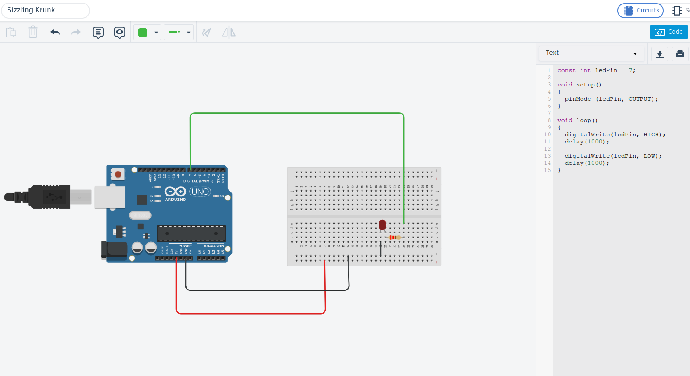

# 2026년 11월 14일 로보틱스 AI 이론 및 실습

## 파일 구조

```text
261114/
├── README.md               # 강의 이론과 실습 설명
├── Thinkercad_code.txt     # Arduino Uno LED 점멸 코드
└── Thinkercad_picture.png  # Tinkercad 회로 이미지
```

## 실행 방법

1. 브라우저에서 Tinkercad에 로그인한 뒤, 대시보드에서 Circuits를 선택하고 Arduino Uno, 브레드보드, LED, **220 Ω 저항**을 배치한다.
2. [회로 이미지](Thinkercad_picture.png)를 참고해 D7 → 저항 → LED → GND 순서로 연결한다. LED의 애노드(+)는 D7 쪽, 캐소드(−)는 GND 쪽을 향하도록 연결한다.
3. **Code → Text**를 선택하고 [실습 코드](Thinkercad_code.txt)의 내용을 붙여넣는다.
4. **Start Simulation**을 눌러 LED가 1초 켜지고 1초 꺼지는 동작을 반복하는지 확인한다.

## 강의 이론

### 로봇 구동 시스템과 제어 계층

로봇은 센서로 주변 환경을 파악하고, 현재 위치와 이동 경로를 추정한 뒤 모터를 제어해 움직인다. 고수준에서 결정한 동작을 저수준에서 하드웨어 제어로 구현하고, 저수준에서 읽은 센서 상태를 다시 판단에 활용한다.

| 구분 | 고수준 판단과 계획 | 저수준 제어 |
| --- | --- | --- |
| 주요 역할 | 카메라·LiDAR 처리, 위치 추정, 지도 작성, 경로·행동 계획 | 모터 PWM 출력, 엔코더 읽기, PID 제어, IMU·초음파 센서 데이터 수집 |
| 중요 요소 | 높은 연산 성능과 메모리 | 정해진 시간 안에 처리하는 실시간성과 일정한 **제어 주기** |
| 대표 하드웨어 | Raspberry Pi, NVIDIA Jetson 개발 키트 등 | ESP32, Arduino Uno와 OpenCR 같은 MCU 기반 보드 |
| 실행 환경 | 주로 Linux와 ROS 2 | Bare-metal 펌웨어 또는 RTOS, 필요에 따라 micro-ROS |
| 주요 언어 | Python, C++ | C, C++ |

따라서 Python,C,C++ 공부 필요하다.
또한 ESP32는 저렴한 가격과 무선통신이라는 장점 때문에 CCTV에 주로 들어가 핵심 기능을 수행한다.

### SBC, MCU, 제어 주기

**SBC(Single Board Computer)**는 한 보드에 컴퓨터의 주요 구성 요소를 갖춘 장치다. Linux에서 여러 프로세스와 라이브러리를 사용할 수 있어 인지와 계획처럼 연산량이 큰 작업에 쓰인다. **MCU(Microcontroller Unit)**는 CPU, 메모리, 입출력 주변장치 등을 한 칩에 통합해 센서와 액추에이터에 직접 연결하기 좋다. MCU는 인간의 근육(단순하게 전압을 느끼고, 전압을 생성)같은 역할을 한다.

제어 주기는 센서 읽기나 출력 갱신을 반복하는 시간 간격이다. 실제 주기는 시스템 요구에 따라 달라진다. 여러 작업이 CPU를 공유하면 실행 시점이 흔들릴 수 있으며, 제어에서는 각 작업이 정해진 시간 안에 끝나는지가 중요하다.
-> 자율 주행 자동차 같은 경우에서 버퍼링이 걸리거나 주기가 정확히 제어되지 않으면 인명 피해가 발생할 수 있기 때문에 정확하게 관리해야한다. -> 짧고 일정한 주기의 제어 수행!

### Linux와 RTOS

- **Linux**는 오픈소스 운영체제로, 패키지 관리와 다양한 라이브러리를 지원한다. Ubuntu는 ROS 2 개발에 널리 사용된다.
- **RTOS**는 시간 제약이 있는 작업을 예측 가능한 방식으로 스케줄링하는 데 중점을 둔다.

### Linux 터미널과 Git 기초

GUI는 그래픽 화면을 사용하고, **CLI**는 터미널 명령으로 작업한다. CLI는 원격 접속과 반복 작업 자동화에 유용하다. `~`와 `$HOME`은 홈 디렉터리를 가리킨다. `/`로 시작하는 경로는 절대 경로이며, 상대 경로는 현재 디렉터리를 기준으로 해석한다. Tab 키로 명령어나 경로를 자동 완성할 수 있다. -> Tab 키 사용 필수!

| 명령어 | 용도 |
| --- | --- |
| `pwd`, `ls` | 현재 위치와 파일 목록 확인 |
| `mkdir`, `cd` | 디렉터리 생성과 이동 |
| `cp`, `mv`, `rm` | 복사, 이동 또는 이름 변경, 삭제 |
| `git add` | 커밋할 변경 사항을 스테이징 |
| `git commit` | 스테이징된 내용을 로컬 기록으로 저장 |
| `git push` | 로컬 커밋을 원격 저장소에 전송 |

### 임베디드 시스템과 ESP32

임베디드 시스템은 자동차 방향지시등 제어기처럼 **제품에 내장되어 특정 기능을 수행**하는 컴퓨팅 시스템이다. 

### 전압, 전류, 저항과 GND

옴의 법칙 `V = I × R`에서 `V`는 전압(V), `I`는 전류(A), `R`은 저항(Ω)이다. LED 회로에서 직렬 저항은 흐르는 전류를 제한한다. VCC는 일반적으로 양의 전원 공급 단자를, GND는 회로의 전압 기준점을 뜻한다.
예를 들어, I(전류)는 폭포에서 떨어지는 물줄기이고, R(저항)은 폭포 중간에 튀어나온 커다란 돌맹이 라고 생각하면 편하다.

**공통 접지(Common Ground). 장치 사이에 전기 신호를 주고받는 일반적인 회로에서는 각 장치의 GND를 서로 연결해 같은 0 V 기준을 사용한다.**
따라서 GND는 전부 연결되어 있어야 한다.
VCC는 전압의 출처 = 전압이 나오는 곳

### GPIO와 디지털·아날로그 신호

GPIO는 범용 입출력 핀이다. 입력으로 버튼이나 센서 상태를 읽고, 출력으로 LED나 모터 드라이버에 신호를 보낸다. 디지털 신호는 HIGH와 LOW 같은 이산적인 상태로 표현한다. 일반적인 ESP32 GPIO는 3.3 V 논리 수준을 사용하므로, 개발 보드의 전원 핀과 GPIO의 허용 전압을 구분해야 한다.

아날로그 신호는 연속적으로 변한다. ADC(Analog-to-Digital Converter)는 입력 전압을 디지털 값으로 변환하고, DAC(Digital-to-Analog Converter)는 디지털 값을 아날로그 출력으로 변환한다. ADC 해상도가 8비트이면 0~255, 10비트이면 0~1023, 12비트이면 0~4095로 표현할 수 있다. ESP32의 ADC 입력 범위는 모델과 설정에 따라 달라진다. 읽은 값을 다른 범위로 바꿀 때는 `map()` 같은 함수를 사용할 수 있다. (예시 : **map(value, 0, 1023, 0, 255)**)

### PWM과 듀티 사이클

PWM은 디지털 출력을 반복해서 켰다 끄며 한 주기 중 HIGH가 유지되는 비율을 조절한다. 0%는 항상 LOW, 50%는 한 주기의 절반이 HIGH, 100%는 항상 HIGH다. 충분히 빠른 주기로 출력하면 LED 밝기를 조절할 수 있고, 모터 드라이버를 통한 속도 제어에도 활용된다. 아래 점멸 실습에서는 두 상태를 각각 1초씩 유지해 LED가 켜지고 꺼지는 모습을 눈으로 확인한다.


## Tinkercad 실습 Arduino Uno LED 점멸

Tinkercad Circuits에서 Arduino Uno의 디지털 출력으로 외부 LED를 점멸시켰다. 이 실습에서는 마이크로컨트롤러가 출력 핀의 상태와 유지 시간을 제어하는 과정을 확인한다.

### 관련 이론

- **저수준 제어**는 센서 입력을 읽거나 하드웨어에 직접 제어 신호를 보내는 역할을 한다. 이 실습에서는 Arduino Uno의 마이크로컨트롤러가 디지털 출력 핀으로 LED를 켜고 끈다.
- **GPIO**는 디지털 입출력에 사용할 수 있는 핀이다. `pinMode(7, OUTPUT)`으로 D7을 출력으로 설정하고, `digitalWrite()`로 출력 상태를 `HIGH` 또는 `LOW`로 바꾼다.
- **LED와 저항(220 Ω)**은 직렬로 연결한다. LED에는 극성이 있으므로 애노드(+)가 D7 쪽, 캐소드(-)가 GND 쪽을 향하도록 연결한다. 직렬 저항은 LED에 흐르는 전류를 제한한다.

### 회로 구성

Arduino Uno, 브레드보드, LED, 저항, 점퍼선을 사용했다. D7에서 출발한 전류 경로는 저항과 LED를 거쳐 Arduino의 GND로 이어진다.



### 실습 코드

[저장소의 원본 코드](Thinkercad_code.txt)

```cpp
const int ledPin = 7;

void setup()
{
  pinMode(ledPin, OUTPUT);
}

void loop()
{
  digitalWrite(ledPin, HIGH);
  delay(1000);

  digitalWrite(ledPin, LOW);
  delay(1000);
}
```

1. `setup()`은 시작할 때 한 번 실행되며 D7(ledPin)을 출력으로 설정한다.
2. `loop()`에서 D7을 `HIGH`로 설정해 LED를 켠다. `delay(1000)`으로 이 상태를 1초 동안 유지한다.
3. D7을 `LOW`로 설정해 LED를 끄고 1초 동안 기다린다. 이후 같은 과정을 반복한다. -> loop()는 while() 이랑 비슷하다.

### 시뮬레이션에서 확인할 동작

1. Tinkercad Circuits에서 위 회로를 구성하고 코드를 입력한다.
2. 시뮬레이션을 시작하고 LED가 1초 동안 켜지고 1초 동안 꺼지는지 확인한다. 켜졌다가 다시 켜지기까지 한 주기는 약 2초다.
3. LED가 켜지지 않으면 코드의 핀 번호와 회로의 D7 연결, LED 극성, 저항과 GND 연결을 확인한다.
