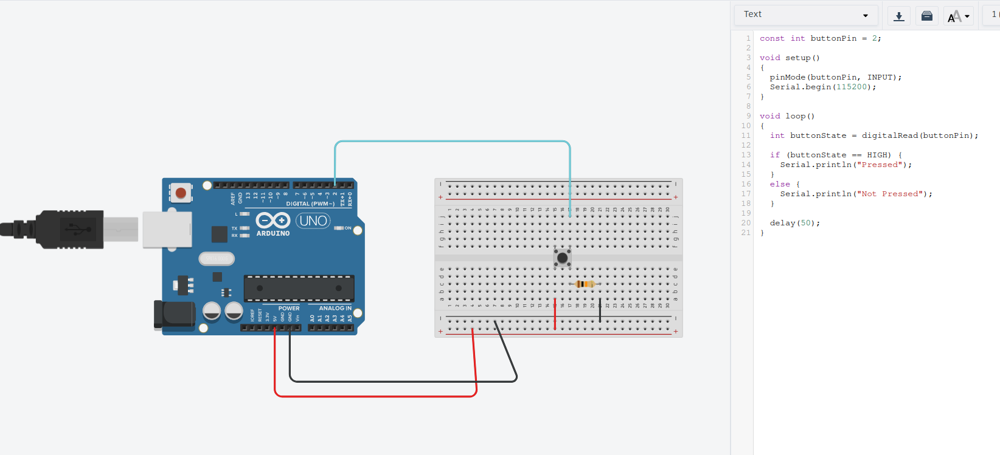
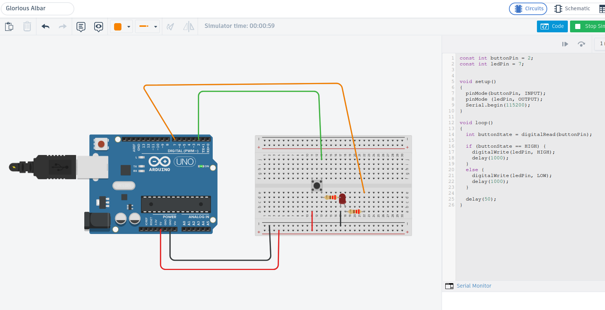
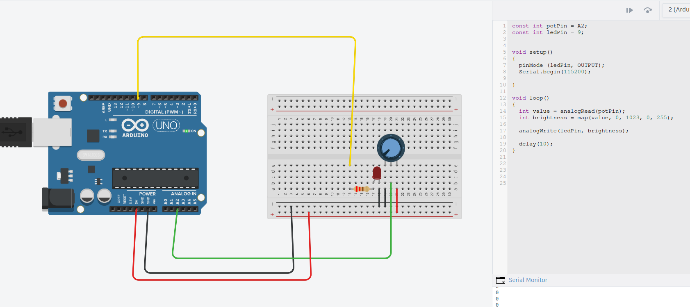

# 2026년 11월 15일 로보틱스 AI 이론 및 실습

## 파일 구조

```text
261115/
├── README.md
├── Thinkercad_Button/
│   ├── Thinkercad_Button_Code.txt
│   └── Thinkercad_Button_Picture.png
├── Thinkercad_Button_Diod/
│   ├── Thinkercad_Button_Diod_Code.txt
│   └── Thinkercad_Button_Diod_Picture.png
├── Thinkercad_Potentiometer/
│   ├── Thinkercad_Potentiometer_Code.txt
│   └── Thinkercad_Potentiometer_Picture.png
└── Arduino/
    ├── Buzzer.txt
    ├── Potentiometer.txt
    ├── Sweep.txt
    └── Potentiometer_Sweep.txt
```

## 실행 방법

### Tinkercad Circuits

1. 브라우저에서 [Tinkercad](https://www.tinkercad.com/circuits)에 로그인하고 대시보드의 **Circuits**에서 새 회로를 만든다.
2. Arduino Uno를 배치하고, 아래 각 실습의 회로 이미지와 핀 번호를 참고해 배선한다.
3. **Code → Text**를 선택하고 해당 실습의 `.txt` 파일 내용을 붙여넣은 뒤 **Start Simulation**을 누른다. 별도 라이브러리 설치나 파일 가져오기는 필요 없다.
4. 버튼 입력 실습에서는 **Serial Monitor**를 열어 출력 메시지를 확인한다. LED 실습에서는 버튼이나 가변저항을 조작하면서 LED의 반응을 확인한다.

### Arduino IDE와 ESP32

1. Arduino IDE의 보드 매니저에서 Espressif의 ESP32 보드 패키지를 설치한다. 부저 코드는 `ledcAttach()`를 사용하므로 Arduino-ESP32 **3.x** 코어가 필요하다.
2. 서보 실습 두 개를 실행할 때는 라이브러리 매니저에서 사용 중인 ESP32 코어와 호환되는 **ESP32Servo**를 설치한다. 가변저항 읽기와 부저 실습은 별도 라이브러리가 필요 없다.
3. 실제 보드의 핀 배치를 확인하고 아래 각 실습에 따라 배선한다. 각 `.txt` 파일은 독립된 스케치이므로, 실행할 파일 하나의 내용을 새 스케치에 붙여넣는다.
4. USB로 보드를 연결해 Arduino IDE에서 보드와 포트를 선택한 뒤 **Upload**를 누른다. `Serial.println()`이 있는 가변저항 실습에서는 시리얼 모니터 속도를 **115200 baud**로 맞춘다.

## 강의 이론

### GPIO와 버튼 입력

`pinMode()`로 GPIO의 입출력 방향을 설정한다. `digitalRead()`는 입력의 HIGH 또는 LOW 상태를 읽고, `digitalWrite()`는 출력 상태를 지정한다. Arduino Uno의 AVR 마이크로컨트롤러에서는 DDR(Data Direction Register)의 해당 비트가 0이면 입력, 1이면 출력이다. ESP32의 레지스터 구성은 AVR과 다르지만 Arduino API에서는 같은 입출력 함수를 사용할 수 있다.

| 버튼 회로 | 놓았을 때 | 눌렀을 때 |
| --- | --- | --- |
| 풀다운 저항을 GND에 연결하고 버튼을 전원에 연결 | LOW | HIGH |
| 풀업 저항을 전원에 연결하고 버튼을 GND에 연결 | HIGH | LOW |

풀업·풀다운 저항은 버튼이 열려 있을 때 입력이 떠서 상태가 불안정해지는 것을 막는다. 버튼이 눌리거나 놓이는 순간 접점이 여러 번 튀는 현상을 **접점 바운스**라고 한다. **디바운싱**은 일정 시간 입력이 안정됐을 때 상태 변화를 인정하는 방법이다. 이번 코드의 `delay()`는 읽는 간격을 늘리지만 입력이 안정됐는지 따로 검사하지는 않는다.

### 가변저항과 ADC

가변저항의 양 끝을 전원과 GND에 연결하면 가운데 단자에서 손잡이 위치에 따라 달라지는 전압을 읽을 수 있다. **ADC(Analog-to-Digital Converter)**는 이 전압을 숫자로 변환한다. Arduino Uno의 10비트 ADC 값은 `0~1023`이고, ESP32에서 12비트 해상도를 사용할 때는 `0~4095`다. 실제 입력 전압 범위와 사용할 수 있는 ADC 핀은 보드와 설정을 확인한다.

### 시리얼 통신과 업로드

직렬 통신은 데이터를 순서대로 보낸다. Baud는 초당 심볼 수를 뜻하며 이진 UART에서는 심볼 하나가 한 비트에 해당한다. `Serial.begin(115200)`으로 UART 속도를 설정하고, 시리얼 모니터도 같은 속도로 맞춘다. USB(Universal Serial Bus)로 보드를 연결한 뒤 Arduino IDE에서 업로드하면 컴파일된 스케치가 ESP32의 플래시 메모리에 기록된다.

### PWM과 LED 밝기

**PWM(Pulse Width Modulation)**은 디지털 출력을 빠르게 켜고 끈다. 듀티 사이클은 한 주기에서 출력이 HIGH인 시간의 비율이다. 듀티가 50%이면 한 주기의 절반 동안 HIGH다. Arduino Uno에서 PWM을 지원하는 D9는 `analogWrite()`에 `0~255`의 값을 전달해 LED 밝기를 조절할 수 있다. `map(value, 0, 1023, 0, 255)`는 ADC 입력을 그 PWM 범위로 변환한다.

### 서보모터와 펄스 폭

위치 제어형 서보는 반복되는 신호에서 **HIGH 펄스의 길이**로 목표 위치를 전달받는다. 약 1,500 µs가 중앙에 해당하는 모델이 있지만, 허용 펄스 폭과 이동 각도는 모델에 따라 다르다. 가변저항으로 위치를 정하려면 ADC 값의 범위를 서보가 지원하는 목표 각도 범위로 매핑한다.

### IMU와 방향 측정

9축 IMU 모듈은 일반적으로 3축 가속도계, 3축 자이로스코프, 3축 자기계로 구성된다. 각각 가속도, 각속도, 자기장을 측정한다. 자기계는 방위를 추정하는 데 쓸 수 있지만, 주변 자석이나 모터의 자기장에 영향을 받는다.

## Tinkercad 실습 Arduino Uno

### 1. 버튼 상태 읽기

버튼을 누르면 D2가 HIGH, 놓으면 풀다운 저항을 통해 LOW가 되도록 배선한다. `digitalRead(2)`의 결과에 따라 시리얼 모니터에 `Pressed` 또는 `Not Pressed`를 출력한다. 코드는 한 번 읽을 때마다 50 ms 대기한다.

[실습 코드](Thinkercad_Button/Thinkercad_Button_Code.txt)



### 2. 버튼으로 LED 제어

D2에 풀다운 방식으로 버튼을 연결하고, D7에서 전류 제한 저항과 LED를 거쳐 GND로 연결한다. D2가 HIGH이면 D7을 HIGH로 만들어 LED를 켜고, LOW이면 LED를 끈다. 두 분기 모두 1,000 ms를 기다린 뒤 추가로 50 ms 대기하므로 버튼 상태를 약 1.05초마다 읽는다. 짧게 누르면 읽는 시점에 따라 입력을 놓칠 수 있다.

[실습 코드](Thinkercad_Button_Diod/Thinkercad_Button_Diod_Code.txt)



### 3. 가변저항으로 LED 밝기 조절

가변저항의 양 끝을 5 V와 GND에, 가운데 단자를 A2에 연결한다. LED는 전류 제한 저항과 직렬로 연결해 D9에서 PWM 신호를 받는다. `analogRead(A2)`로 읽은 `0~1023`을 `map()`으로 `0~255`에 대응시킨 뒤 `analogWrite(9, brightness)`에 전달한다. 손잡이를 돌려 LED 밝기가 달라지는지 확인한다.

[실습 코드](Thinkercad_Potentiometer/Thinkercad_Potentiometer_Code.txt)



## Arduino IDE 실습 ESP32

아래 GPIO 번호는 저장소 코드 기준이다. GPIO39를 ADC 입력으로 지원하는 보드에서 가변저항의 양 끝을 3.3 V와 GND에 연결하고 가운데 단자를 GPIO39에 연결한다. 서보의 신호선은 GPIO14에 연결하고, 서보 전원은 모델의 정격에 맞추며 ESP32와 GND 기준을 공유한다. 부저도 부품의 정격에 맞는 구동 회로를 사용하고 GPIO5는 제어 신호로 사용한다.

### 1. 가변저항 값 읽기

[실습 코드](Arduino/Potentiometer.txt)는 `analogRead(39)`로 입력값을 읽고 시리얼 모니터에 출력한다. 각 출력 뒤에 50 ms 대기한다. 손잡이를 돌려 값이 변하는지 확인한다.

### 2. 서보 각도 명령 보내기

[실습 코드](Arduino/Sweep.txt)는 `ESP32Servo.h`를 사용한다. GPIO14에 서보 신호를 설정하고 `write()`로 0°부터 170°까지 10°씩 증가하는 명령과, 180°부터 10°까지 10°씩 감소하는 명령을 반복한다. 각 명령 사이에 대기 시간이 없으므로 서보가 각 위치에 도달하는 단계별 왕복 동작을 확인하려면 서보의 응답 시간에 맞춰 대기 시간을 두어야 한다.

### 3. 가변저항과 서보 연동

[실습 코드](Arduino/Potentiometer_Sweep.txt)는 GPIO39의 ADC 값을 시리얼로 출력하고, 읽은 값을 상한으로 삼아 GPIO14 서보의 `write()` 인수를 증가시켰다가 감소시킨다.

수업 노트에서 다룬 매핑은 저장된 코드에 구현되어 있지 않다. ADC 값은 180보다 클 수 있고, ESP32Servo의 `write()`는 큰 값을 펄스 폭으로 해석할 수 있다. 가변저항 위치에 따라 목표 각도를 정하려면 실제 ADC 입력 범위를 서보의 유효 각도 범위로 `map()`한 뒤 그 각도를 전달한다. 단계별로 움직이는 동작이 필요하면 각 명령 사이에 대기 시간도 둔다. [ESP32Servo 구현](https://github.com/madhephaestus/ESP32Servo/blob/master/src/ESP32Servo.cpp)

### 4. PWM 부저 제어

[실습 코드](Arduino/Buzzer.txt)는 `ledcAttach(5, 2000, 8)`로 GPIO5에 **2,000 Hz, 8비트** PWM을 설정한다. 이후 `ledcWrite()`로 듀티 설정값을 **32 → 64 → 128 → 0** 순서로 바꾸며 각 상태를 1초씩 유지한다. 32, 64, 128은 각각 약 12.5%, 25%, 50%의 듀티에 해당한다. 주파수는 일정하며, 실제 소리의 크기 변화는 부저 종류와 구동 회로에 따라 달라진다. [Espressif Arduino-ESP32 3.0 변경 안내](https://docs.espressif.com/projects/arduino-esp32/en/latest/migration_guides/2.x_to_3.0.html)
