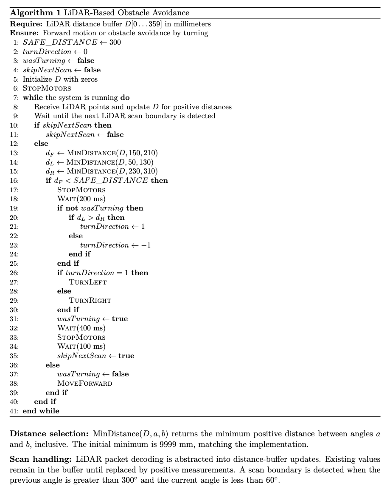

# Project01 — LiDAR 기반 장애물 회피 로봇

## 1. 프로젝트 개요

LiDAR로 주변 거리를 측정하고, 전방 장애물의 유무에 따라 전진하거나 회전하는 로봇을 구현하였다. ESP32가 LiDAR 데이터를 수신하고 네 개 모터의 방향을 제어한다.

전방 거리가 300 mm 미만이면 정지한 뒤 좌우 거리를 비교하여 회전 방향을 선택한다. 전방이 계속 막혀 있으면 같은 방향으로 회전하고, 전방에 여유가 생기면 다시 전진하도록 구성하였다.

## 2. 이론 및 핵심 기술

**LiDAR 거리 측정:** LiDAR는 레이저를 이용해 주변 물체까지의 거리를 측정하는 센서이다. 이번 코드에서는 각도별 거리 데이터를 저장하고, 전방·좌측·우측 영역에서 가장 가까운 거리로 장애물을 판단한다.

**UART 통신:** LiDAR와 ESP32는 직렬 통신으로 데이터를 주고받는다. ESP32는 센서에서 전달한 바이트를 패킷으로 읽고, 거리와 각도 정보를 해석한다.

**모터 방향 제어:** 모터 드라이버의 입력 핀을 HIGH 또는 LOW로 설정하여 회전 방향을 바꾼다. 좌회전은 오른쪽 바퀴 전진·왼쪽 바퀴 후진, 우회전은 그 반대로 동작한다. 현재 코드는 PWM 속도 조절 없이 방향을 제어한다.

**상태 유지:** 장애물 회피 중 방향을 계속 바꾸지 않도록 `wasTurning`과 `turnDirection`을 사용한다. 회전 직후에는 `skipNextScan`으로 다음 한 번의 스캔 경계에서 판단을 건너뛴다.

## 3. 사용 환경 및 파일

사용 장비는 ESP32 기반 보드, UART LiDAR, 모터 드라이버와 네 개 모터이다. 개발에는 Arduino IDE와 ESP32용 보드 패키지를 사용한다. 코드는 별도의 외부 센서 라이브러리를 호출하지 않는다.

| 파일 | 내용 |
| --- | --- |
| [project01/project01.ino](project01/project01.ino) | LiDAR 수신 및 장애물 회피 제어 코드 |
| [Algorithm.png](Algorithm.png) | 알고리즘 의사코드 이미지 |
| [Demo_Video.mp4](Demo_Video.mp4) | 시연 영상 |
| README.md | 프로젝트 기술 문서 |

코드에서 사용하는 핀은 다음과 같다.

| 연결 대상 | ESP32 GPIO |
| --- | --- |
| LiDAR TX → ESP32 RX | 16 |
| 앞 오른쪽 모터 IN1 / IN2 | 26 / 25 |
| 앞 왼쪽 모터 IN1 / IN2 | 19 / 27 |
| 뒤 오른쪽 모터 IN1 / IN2 | 23 / 12 |
| 뒤 왼쪽 모터 IN1 / IN2 | 0 / 15 |

전원은 실제 센서와 모터 드라이버의 사양에 맞게 연결하고, 통신·제어 회로의 GND를 공통으로 연결한다. 모터는 ESP32 GPIO에 직접 연결하지 않고 드라이버를 통해 구동한다.

## 4. 구현 과정과 동작

1. 모터 제어 핀을 출력으로 설정하고 초기 상태를 정지로 만든다.
2. LiDAR UART를 230400 baud로 초기화한다.
3. 헤더가 `0x54`, `0x2C`인 47바이트 패킷을 수신한다.
4. 패킷의 시작·끝 각도로 측정점 12개의 각도를 계산하고, 양수인 거리를 각도별 배열에 저장한다.
5. 각도가 360도에서 0도로 넘어가는 스캔 경계에서 장애물 회피 여부를 판단한다.
6. 전방이 막혀 있으면 정지·회전하고, 그렇지 않으면 전진한다.

거리 배열은 0~359도의 슬롯을 사용하며 거리 단위는 mm이다. 실습의 차체 기준 방향은 뒤 0도, 왼쪽 90도, 앞 180도, 오른쪽 270도이다.

| 측정 영역 | 각도 범위 | 사용하는 값 |
| --- | --- | --- |
| 전방 | 150~210도 | 범위 내 최소 양수 거리 |
| 좌측 | 50~130도 | 범위 내 최소 양수 거리 |
| 우측 | 230~310도 | 범위 내 최소 양수 거리 |

전방 최소 거리가 **300 mm 미만**이면 모터를 정지하고 200 ms 대기한다. 처음 마주친 장애물은 좌우 거리를 비교하여 더 넓은 방향으로 회전한다. 좌우 거리가 같으면 오른쪽을 선택한다.

회전은 400 ms 동안 수행하고, 정지 후 100 ms 대기한다. 다음 스캔 경계에서는 판단을 한 번 건너뛰고 정지 상태를 유지한다. 이후에도 전방이 막혀 있으면 이전 회전 방향을 유지한다. 전방 거리가 300 mm 이상이면 회전 상태를 해제하고 전진한다.

## 5. 장애물 회피 알고리즘

LiDAR 패킷을 해석하는 세부 과정은 거리 배열 갱신 단계로 묶어서 표현하였다.

- `SAFE_DISTANCE`: 장애물 판단 기준인 300 mm
- `turnDirection`: 좌회전은 1, 우회전은 -1
- `wasTurning`: 이전 판단에서 회전했는지 나타내는 상태
- `skipNextScan`: 회전 직후 다음 스캔 경계의 판단을 건너뛰는 상태

`MinDistance`는 지정된 각도 범위에서 최소 양수 거리를 찾는다. 초기값은 9999 mm이며 유효한 값이 없으면 그대로 반환된다. 따라서 9999를 실제 측정 거리로 해석해서는 안 된다.

## 6. 실행 방법

1. Arduino IDE에 ESP32용 보드 패키지를 준비한다.
2. `project01` 폴더 안의 `project01.ino`를 연다.
3. 위 핀 배치에 맞게 LiDAR와 모터 드라이버를 연결한다.
4. 실제 사용하는 ESP32 보드와 연결 포트를 선택한다.
5. 코드를 컴파일하고 보드에 업로드한다.
6. 시리얼 모니터를 **115200 baud**로 열어 장애물 감지 거리와 회전 방향 로그를 확인한다.
7. 주변 공간을 확보한 뒤 전방과 좌우에 물체를 놓아 전진·정지·회전 동작을 확인한다.

시리얼 모니터의 115200 baud와 LiDAR 수신용 UART의 230400 baud는 서로 다른 설정이다. 전원이 켜지고 코드가 실행되면 별도의 시작 입력 없이 반복 동작한다.

## 7. 시연 영상 및 한계

[시연 영상 보기](Demo_Video.mp4)

첨부 영상은 프로젝트 시연 영상이다. 
